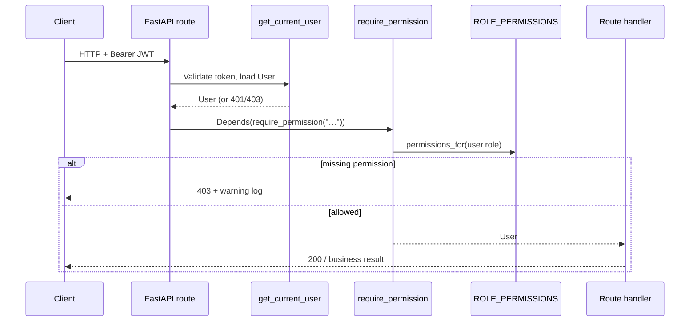

# Full Stack FastAPI Template — RBAC

Role-based access control (RBAC) on top of the [Full Stack FastAPI Template](https://github.com/fastapi/full-stack-fastapi-template).

This repository implements the assignment in [`TASK.md`](./TASK.md). Planning and design notes live in [`PLAN.md`](./PLAN.md) and [`DECISION.md`](./DECISION.md).

Upstream / original template documentation is preserved in [`README_FastApi.md`](./README_FastApi.md) and [`development.md`](./development.md).

## Stack

- **Backend:** Python, FastAPI, SQLModel
- **Database:** PostgreSQL
- **Frontend:** React, TypeScript, TanStack Router
- **Local run:** Docker Compose

## Quick start (Docker Compose)

Requirements: Docker Desktop with Compose v2.

```bash
# From the repository root
docker compose run --rm backend bash scripts/prestart.sh
docker compose up -d
```

Then open:

| URL | Purpose |
|-----|---------|
| http://localhost:8000 | App (frontend + API) |
| http://localhost:8000/docs | OpenAPI / Swagger |
| http://localhost:8080 | Adminer (DB UI) |
| http://localhost:8025 | Mailpit |

After code changes that affect the backend image or built frontend:

```bash
docker compose up -d --build backend
docker compose run --rm backend bash scripts/prestart.sh
```

> **Note:** Backend tests use the same local Postgres. The test teardown re-seeds demo users, but if login fails after a test run, re-run `prestart.sh`.

## Demo users (seeded)

Created idempotently by `init_db` during `prestart` (`backend/app/core/db.py`):

| Email | Password | Role |
|-------|----------|------|
| `admin@example.com` | `changethis` | admin |
| `manager@example.com` | `changethis` | manager |
| `member@example.com` | `changethis` | member |

Passwords match `.env` defaults (`FIRST_SUPERUSER` / `FIRST_SUPERUSER_PASSWORD`). Change them before any real deployment.

## Permission matrix

| Action | Permission key | admin | manager | member |
|--------|----------------|:-----:|:-------:|:------:|
| List all users | `users:list` | ✓ | ✓ | ✗ |
| Create user | `users:create` | ✓ | ✗ | ✗ |
| Update any user / assign roles | `users:update` | ✓ | ✗ | ✗ |
| Delete user | `users:delete` | ✓ | ✗ | ✗ |
| View metrics | `metrics:read` | ✓ | ✓ | ✗ |
| Update own profile | `profile:update` | ✓ | ✓ | ✓ |
| System (global) settings | `settings:write` | ✓ | ✗ | ✗ |

Public signup always creates a **member**. Own-profile routes (`/users/me`) stay available to every authenticated active user.

## Authorization approach

### Where roles live

- Users have a `role` column: `admin` | `manager` | `member` (source of truth).
- Legacy `is_superuser` is kept in sync (`True` only when `role == admin`) for gradual migration.
- Alembic migration: `backend/app/alembic/versions/b7e3a1c94d20_add_user_role.py`.

### Where checks live (backend)

1. **Policy map** — `backend/app/core/rbac.py`  
   Single `ROLE_PERMISSIONS` dict maps each role to permission strings.
2. **Dependency** — `require_permission("users:list")` in `backend/app/api/deps.py`  
   Used on protected routes; denied attempts are logged at WARNING (user id, role, permission, path) and return **403**.
3. **Object-level rules** — e.g. reading another user requires `users:list`; self-service profile updates use `profile:update`.

The UI is not a security boundary. Direct API calls must still pass these checks.

### How the frontend learns capabilities

- `UserPublic` (including `GET /users/me`) includes `role` and `permissions: string[]`, computed from the same backend policy map.
- Frontend helper `can(user, permission)` in `frontend/src/lib/permissions.ts` drives:
  - sidebar visibility
  - route guards (`beforeLoad` → `/forbidden`)
  - admin create/edit/delete actions

### AuthZ flow



## Migrations

```bash
docker compose run --rm backend bash scripts/prestart.sh
# runs: alembic upgrade head + initial_data (seed)
```

New schema changes should be added under `backend/app/alembic/versions/`.

## Tests

Focused RBAC scenarios: `backend/tests/api/routes/test_rbac.py`.

```bash
docker compose run --rm \
  -v "${PWD}/backend/app:/app/backend/app" \
  -v "${PWD}/backend/tests:/app/backend/tests" \
  backend bash -c "coverage run -m pytest tests/api/routes/test_rbac.py -q"
```

Or, with source synced (e.g. `docker compose watch` / mounted app+tests):

```bash
docker compose exec backend bash scripts/tests-start.sh tests/api/routes/test_rbac.py
```

## Project docs

| File | Contents |
|------|----------|
| [`TASK.md`](./TASK.md) | Assignment brief |
| [`PLAN.md`](./PLAN.md) | Implementation plan and phase status |
| [`DECISION.md`](./DECISION.md) | Detailed architecture decisions (D1–D5) |
| [`NOTES.md`](./NOTES.md) | Trade-offs, scope notes, follow-ups |
| [`docs/adr/`](./docs/adr/) | Short ADRs + diagram |
| [`README_FastApi.md`](./README_FastApi.md) | Original upstream template README |

## License

The Full Stack FastAPI Template is licensed under the terms of the MIT license.
