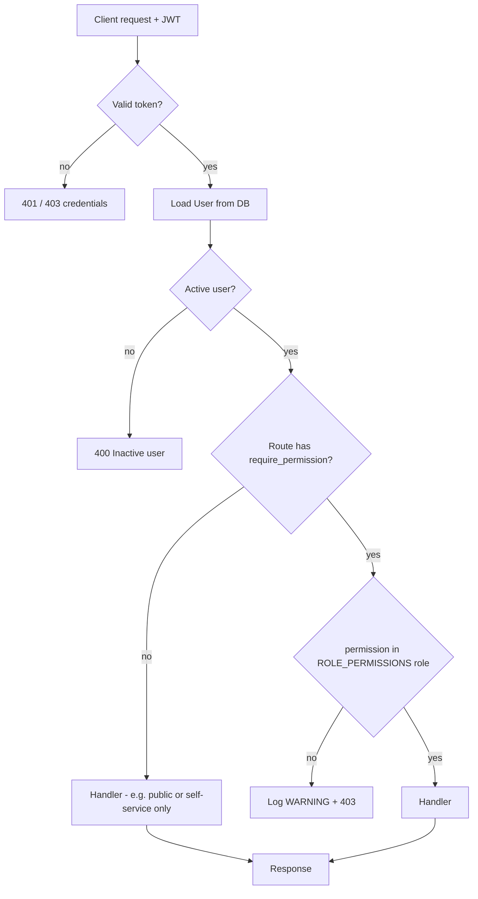

# Authorization check flow

Protected examples:

- `GET /api/v1/users/` → `users:list`
- `POST /api/v1/users/` → `users:create`
- `GET /api/v1/metrics/` → `metrics:read`
- `GET/PATCH /api/v1/settings/system` → `settings:write`
